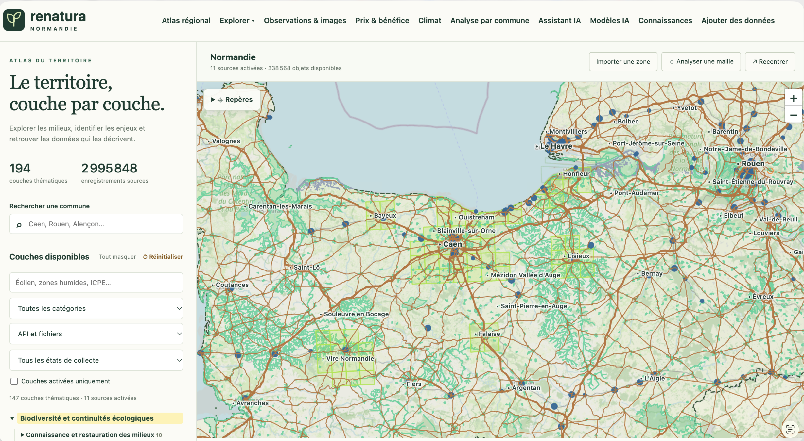
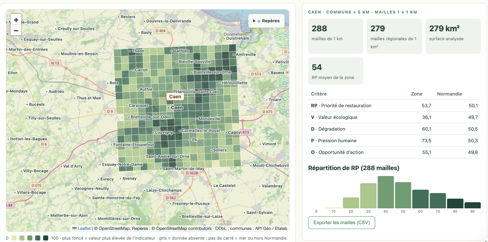

# Renatura Normandie

A local-first restoration decision-support atlas and scenario laboratory.

**Working pilot, not a completed region-wide ecological assessment.** This release
ships real, processed DREAL data for FR2502014 (Bocages et vergers du sud Pays
d’Auge), 280 clipped hexagonal planning cells, five offline ILP scenarios and
1,000 weight-sensitivity runs. Human pressure (P) and land opportunity (O) remain
unavailable. The interface labels the resulting V+D index as **partial**.

## Screenshots

**Regional atlas.** The Normandy map built up layer by layer, with thematic layers, collected sources and commune search.



**Commune analysis.** Caen plus a 5 km buffer, split into 1 × 1 km cells. Each cell is scored for restoration priority (RP) and compared with the Normandy average on each criterion (V, D, P, O).



## Run Renatura

**The only supported way to run Renatura is to create the virtual environment, then launch `run-atlas.sh`.**
This is the only method that starts every part of the system together: the regional atlas, the Pays d’Auge pilot,
the data workflow, the AI assistant and its knowledge base, and the analysis APIs.
Other methods (opening the HTML files, a plain static file server) leave the APIs unreachable,
and those pages show "Not Found".

From this project folder, with Python 3.10 or newer:

```bash
python3 -m venv .venv-atlas
.venv-atlas/bin/python -m pip install -r requirements-atlas.txt
chmod +x run-atlas.sh
./run-atlas.sh
```

Then open `http://localhost:8080/`. `run-atlas.sh` reinstalls `requirements-atlas.txt` on each launch,
so the environment stays in step with the code. The server listens on `127.0.0.1` only.

What the server starts:

| Part | URL |
|---|---|
| Regional atlas (home page) and Pays d’Auge pilot | `/`, `/pays-auge.html` |
| Data workflow (Atelier de données: intake → validation → quarantine → populate, logged jobs) | `/workbench` |
| AI assistant and knowledge base (RAG documents, search) | `/connaissances.html`, `/api/assistant/*` |
| Data import (GeoJSON / CSV / WFS) | `/api/...` |
| Custom polygon analysis | `/api/analyse` |

Settings for specific parts, all passed to `run-atlas.sh`:

- **Polygon analysis**: start with `RENATURA_SPATIAL_DB=/path/to/normandie.sqlite ./run-atlas.sh`.
- **Assistant chat**: the knowledge base works on its own. Chat answers need a model. By default the assistant uses a
  local [Ollama](https://ollama.com) model. Pull it once with `ollama pull qwen2.5:7b-instruct` and keep Ollama
  running. For another model, set `RENATURA_LLM_URL`, `RENATURA_LLM_MODEL` and `HF_TOKEN` (for Hugging Face).
- **Semantic search**: install it with `.venv-atlas/bin/python -m pip install sentence-transformers`. It is large,
  because it pulls in PyTorch. Without it, search matches exact words.
- **Empty knowledge base**: import the corpus with `.venv-atlas/bin/python -m pipeline.assistant.knowledge build`.

If a page shows "Not Found", read the start-up log of `run-atlas.sh`. A line such as `Assistant not mounted: …` or
`Atelier de données not mounted: …` names the missing package.

## Rebuild everything from the included real source snapshots

Use Python **3.12**. On macOS or Linux:

```bash
bash run.sh --config configs/pays-auge.json
```

This creates a virtual environment, installs pinned direct dependencies,
reprocesses source snapshots, rebuilds the static data and runs Python tests.
The first dependency installation needs internet access. Subsequent processing
can run offline when the environment and raw snapshots are present.

For Windows PowerShell:

```powershell
py -3.12 -m venv .venv
.venv\Scripts\python -m pip install -r requirements.txt
.venv\Scripts\python -m pipeline.build --config configs/pays-auge.json
.venv\Scripts\python -m unittest discover -s tests -p "test_*.py"
```

Run the browser numerical tests with Node 22+:

```bash
node --test tests/core.test.js
```

Raw snapshots are included to avoid dependence on changing upstream archives.
Remove or move a raw file only when intentionally downloading a newer snapshot.
Changing inputs changes the analysis. Keep its new checksum and review metadata.
No missing input is replaced with fictional data.

## Architecture

```text
pipeline/          Reproducible Python stages
configs/           Model and preset configuration
raw/               Official source archive snapshots and commune API snapshot
 derived/          Generated GeoParquet (created on rebuild)
dist/              Web front end and data, served by run-atlas.sh
  data/            Real aggregated data, scenarios, graph, sensitivity, catalogue
  core.js          Pure numerical functions
  worker.js        Bounded browser optimisation and sensitivity
  map.js           Local MapLibre map and keyboard-accessible SVG fallback
  app.js           State, filters, details, exports and scenario workflow
  documents.js     Transparent methodology and data catalogue UI
  sw.js            Versioned same-origin offline cache
 tests/            Synthetic test fixtures and real-export integrity checks
 docs/             Methodology, validation, pitch and roadmap
```

Plain Python was selected instead of Apache Hop: geospatial operations,
NetworkX, PuLP and statistical analysis already run in Python, so a separate
orchestration runtime would add setup and maintenance. DuckDB reads GeoParquet
for QA; GeoPandas/Shapely handle actual spatial operations. No DuckDB spatial
extension download is required. Hadoop and Spark are not dependencies.

MapLibre is self-hosted, version 5.6.2. There is no remote basemap, terrain service,
font service, tracker, account integration or runtime AI call. The map draws real
pilot geometry on a neutral background; it must not be confused with a complete
street or terrain map. No deck.gl dependency is needed: MapLibre renders native
polygon extrusions. The fallback provides 2D cells and table-based access.

## What works

- Real-data 2D/3D map, navigation, reset, scale and attribution.
- Cell inspection with raw measurements, source and score breakdown.
- Municipality and cell search, metric filter, criterion-coverage filter.
- Four editable weights, partial-mode toggle and shareable filter URL.
- Lazy historical hedgerow layers for 1947, 2010 and 2016.
- Woodland, official boundary and modelled least-cost connections.
- Five precomputed PuLP/CBC binary optimisation scenarios.
- Browser-local bounded search for custom site, area or proxy constraints.
- Connectivity-completion bonuses, baseline comparison, upper bound and gap.
- Stale-result invalidation when the calculation parameters change.
- Offline 1,000-run sensitivity plus optional 200-run browser recalculation.
- CSV, GeoJSON, scenario JSON and sensitivity JSON exports.
- French-default interface and English core UI/methodology.
- Responsive tablet layout, focus styling and reduced-motion map transitions.
- Service-worker cache, including explicit preparation of optional data layers.

## What is intentionally not claimed

- No full four-criterion RP, no pressure layer and no land-feasibility estimate.
- No protection score: neighbouring human pressure is missing.
- No region-wide Normandy coverage, EPCI lookup or current ecological survey.
- No verified restoration parcels, real costs, ownership or permissions.
- No species-specific connectivity calibration or three-site expert validation.
- No terrain basemap, NSGA-II/Pareto front or unattended iPad background jobs.
- No measured 60 fps, five-second broadband load or physical iPad benchmark.
- No completed full browser visual QA in the build environment.

## Scenarios and solver honesty

Offline scenarios use binary ILP with PuLP/CBC. Each candidate connection gets a
binary completion variable; its gain is earned only when every intermediate
cell is selected. The required sites may serve several different pairwise
connections. The resulting gain is a **model index**, not unique habitat area.

The naive reference sorts by partial RP and adds a site only if it fits the same
resource limit. For a site-count limit without connectivity, this reference is
already optimal and the reported improvement must be zero.

Custom browser scenarios use a bundle-aware greedy incumbent followed by bounded
branch-and-bound. Search ends after 3 seconds or 200,000 nodes. Results are labelled
OPTIMAL only when all branches are exhausted/pruned or the top-N special case
applies. Otherwise FEASIBLE is shown, with a valid conservative upper bound.
The “maximum gap” can be wide: it is not a prediction of actual error.

Preset loading resets weights and filters to the preset's original assumptions.
Live custom scenarios apply the currently filtered candidate set. Exports include
that scope. Sensitivity runs always cover the entire pilot, independent of filters.

## Reproducibility details

- EPSG:2154 for metric calculations; EPSG:4326 for web display.
- Source archive SHA-256 hashes in `dist/data/data_catalog.json`.
- Every static data file has a checksum in `dist/data/manifest.json`.
- Random seed 42, CBC one thread and configured random seed.
- Same inputs produce equal analytical outputs on the tested environment.
- Timestamps and their manifest hashes intentionally change on rebuild.
- Different dependency platforms may create numerically equivalent but not
  byte-identical geometry. Direct versions are pinned; see validation report.
- Build updates the service-worker cache version from source and data hashes.

## Licensing

Original code: MIT, see LICENSE. DREAL and administrative data retain their
Licence Ouverte 2.0 attribution; consult `data_catalog.json` for provenance.
MapLibre GL JS is BSD-3-Clause; see `docs/MAPLIBRE-LICENSE.txt`.
Do not strip source attribution from exports or republished datasets.
